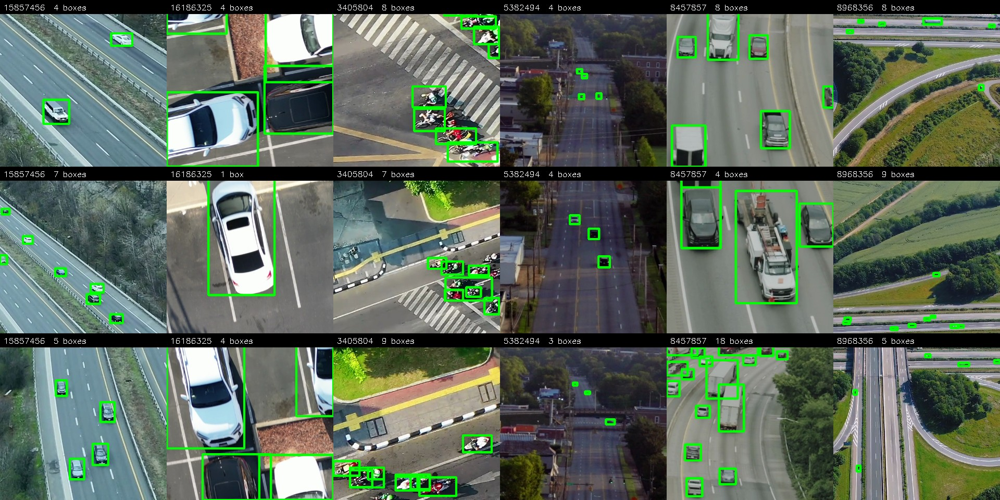
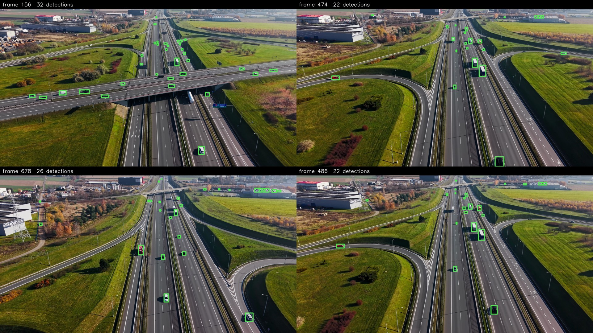
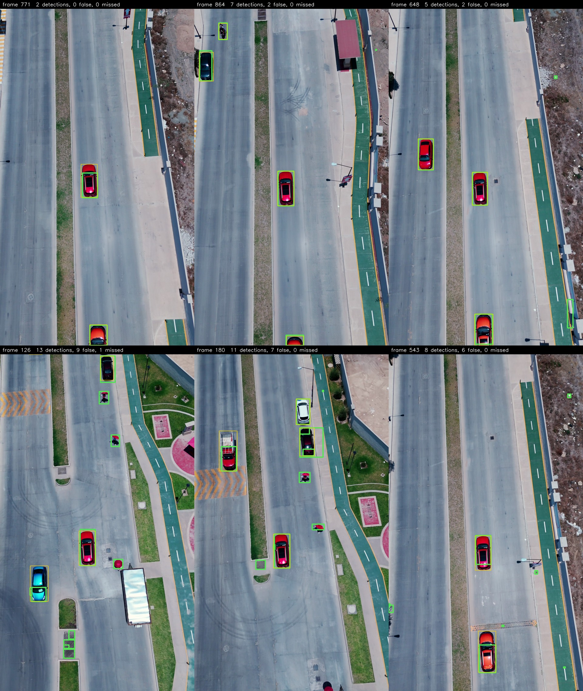
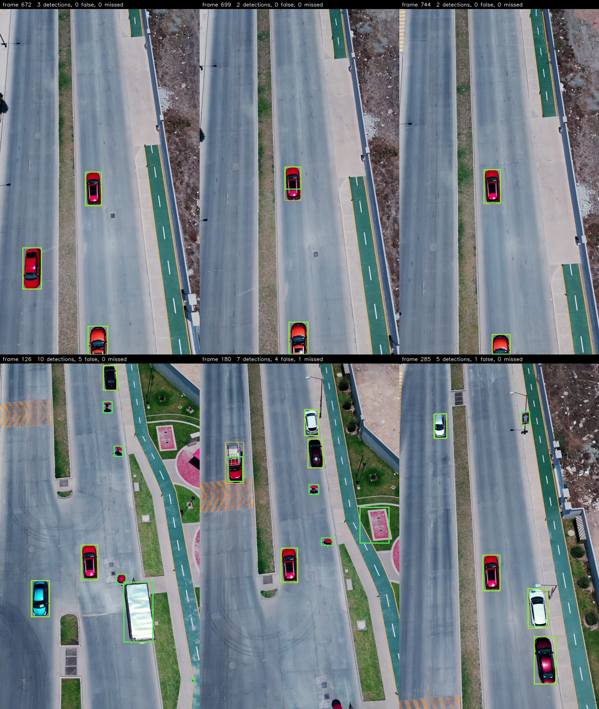
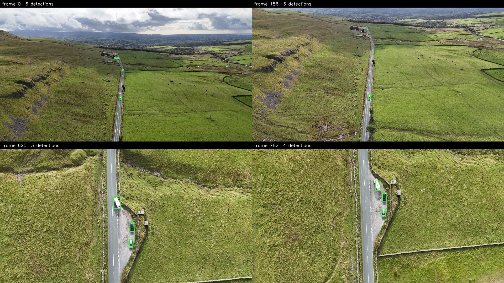
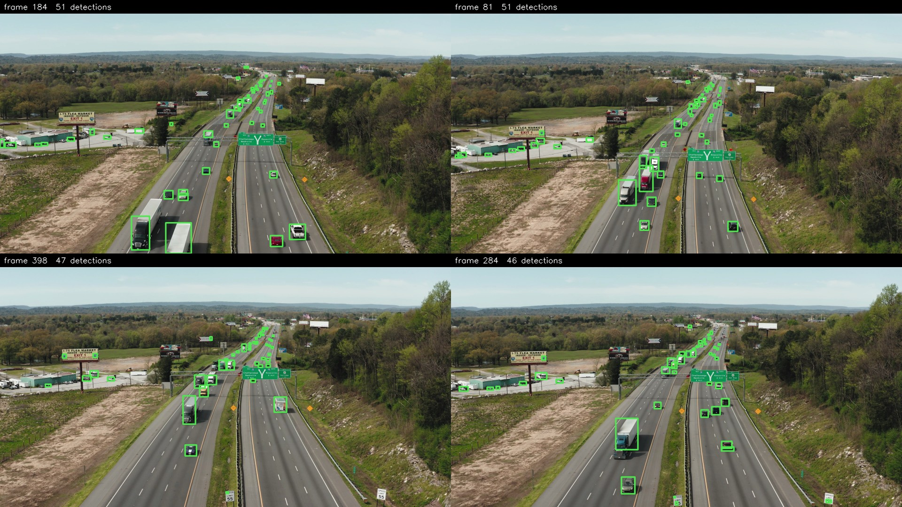

# Aerial vehicle detection

A single-class vehicle detector for drone footage: **490,482 parameters**,
labels generated by models and corrected by hand, metrics reported separately
for 0–200 m and 200–400 m.

| | |
|---|---|
| Detector | 490,482 parameters (budget 500,000), YOLOv8 with the P5 branch removed |
| mAP@0.5 | 0.66 near, 0.57 far, **0.64 over both bands** |
| Shipping threshold | 0.50, chosen on validation |

The intended eval clip (Pexels 32179597) cannot be downloaded — the page
returns 403 to scripted requests — so **13722965** stands in. It is the harder
test by a wide margin: **its vehicles are mostly under 20 m** (83% of boxes,
median 14.5 m), while the **validation clip covers 40–200 m and 200–400 m**.

Detail lives in [data and labels](docs/data-and-labels.md),
[experiments](docs/experiments.md) and [commands](docs/pipeline.md). `weights/`
holds the checkpoint and its ONNX export; `examples/` holds the tile grids, the
eval frames with ground truth, and the detector videos.

**AI use.** I worked with an AI agent (Claude Code): it wrote this README and
much of the code and ran the measurements, under my direction. I set the steps,
reviewed the results and made the decisions.

## Running the detector on a video

An ONNX graph plus a container, so no training stack is needed. Drop clips into
`videos/in` and read `videos/out`, or point the container at any folder.

```
docker compose run --rm detect                       # whatever is in videos/in
docker compose run --rm -v /abs/path/to/clips:/app/videos/in:ro \
    -v /abs/path/to/results:/app/videos/out detect   # any folder
```

Each clip produces `<name>.mp4` with boxes drawn and `<name>.csv`. Flags pass
through (`--conf`, `--seconds`, `--input-scale 0.25` for footage below ~50 m);
without Docker the entry point is `eval/detect_onnx.py`.

## Data

All clips are free Pexels videos, linked rather than redistributed.

| Clip | Role | Scene | Tiles | Boxes |
|---|---|---|---|---|
| [8968356](https://www.pexels.com/video/8968356/) | train | highway interchange | 506 | 3156 |
| [5382494](https://www.pexels.com/video/5382494/) | train | rural highway | 787 | 784 |
| [8457857](https://www.pexels.com/video/8457857/) | train | top-down highway | 244 | 755 |
| [3405804](https://www.pexels.com/video/3405804/) | train | urban intersection | 469 | 404 |
| [15857456](https://www.pexels.com/video/15857456/) | train | wide highway, added for the far band | 794 | 3878 |
| [16186325](https://www.pexels.com/video/16186325/) | train | car park at ~12 m | 500 | 684 |
| **Train total** | | | **3300** | **9661** |
| [14710575](https://www.pexels.com/video/14710575/) | val | interchange | 698 | 747 |
| [13722965](https://www.pexels.com/video/13722965/) | eval | low-altitude street | full frames | 833 |

Frames are cut into **512 px tiles** rather than downscaled: a distant vehicle
is 10–20 px and vanishes at 640 px full-frame inference. Inference uses the same tiling.

The repo ships the **labels**, not the images: `data/labels.zip` plus
`labeling/recut_tiles.py` rebuilds the tiles from the clips exactly, checked
pixel-identical on a sample of tiles.

**897 of the 3998 tiles (22%) hold no vehicle**, on purpose: a tiled detector spends
most of its inference on empty ground. Emptiness is **verified** by the
open-vocabulary detector, and similar tiles are removed: k-means over image
features, one tile kept per cluster, because a hovering drone yields hundreds of
near-identical grass tiles.



*Three labelled tiles from each clip; the list is in
`examples/dataset_by_clip.txt`.*


## Labels

No box is drawn from scratch. YOLO-World with "…seen from above" prompts proposes
boxes over tiled frames, with distractor prompts (lane paint, rooftops, kerbs)
absorbing false positives. A custom intermediate detector and YOLOE give second
opinions, a vehicle/non-vehicle crop classifier scores the crops, and targeted
passes fix known failures. Label Studio review starts from these pre-annotations.

**How far models alone get.** Measured afterwards on the 2800 main tiles against
their 8977 final boxes, IoU ≥ 0.5. YOLO-World at 0.25 proposes 9,313 boxes: 5,243
match, 2,762 are unmatched, 1,308 are misplaced, and 3,734 final boxes are not
found. Requiring agreement with stock COCO YOLO (both at 0.10) proposes 6,372:
5,483 match (86%), 889 do not, and 3,494 final boxes are missing.

**What the review changed.** Over 311 of the 2800 tiles: **654 boxes added, 229
removed, 50 moved or resized**, 1729 left alone, then 120 slivers under 7 px
dropped.

## The model

490,482 parameters against a 500,000 budget — it runs on a small board — and
2.8 GFLOPs on a 512 px tile.
Two cuts to the YOLOv8 layout
(`configs/vehicle_tiny_p34.yaml`); yolov8n built for one class is 3,011,043
parameters, so this is 6.1× smaller:

- **P5 (stride-32) removed**, backbone and head, leaving P3/8 and P4/16. P4 reaches box
sides of 480 px, and only 9 of 9661 labelled boxes exceed that.
- **width 0.25, channels capped at 192** (yolov8n caps at 1024), so no layer
  exceeds 48 channels.

The head holds 322,994 parameters (66%). It is also why the count exceeds the 388,786 the architecture file gives alone — the class branch
is sized `max(channels, min(classes, 100))`, so the fine-tune inherits the
pretrain's 80-wide branch.

Four runs, measured identically on the same 698 validation tiles:

| | Parameters | Pretrain | mAP@0.5 | Recall |
|---|---|---|---|---|
| Scratch | 388,786 | none | 0.740 | 0.614 |
| Scratch, wide | 480,970 | none | 0.770 | 0.671 |
| **COCO pretrain, shipped** | **490,482** | COCO vehicles | **0.826** | **0.739** |
| COCO pretrain, wide | 564,154 | COCO vehicles | 0.845 | 0.750 |

The wide pretrained model cannot ship: it is over budget. The shipped model has a
more varied training set; on the eval clip at native resolution they score 0.60
and 0.21 mAP.

### Recommended altitude: 50–400 m

The usable range follows from the box sizes in the dataset. Through the pinhole
model the training boxes read 12 px → 785 m at the 5th percentile, 28 px →
343 m at the median and 176 px → 55 m at the 90th, so 90% of the signal sits
between roughly 55 m and 785 m and 46% of boxes fall inside 50–400 m. Above
~400 m vehicles drop under 24 px, toward the 7 px floor the labels allow, and
recall degrades gradually. Below ~50 m they outgrow anything the clips hold and
the model boxes part of a vehicle instead of all of it.

**The eval clip is the evidence.** Its vehicles sit far below the band. Scaling the frame by 0.25 puts them back in the trained size range
without touching the weights, and mAP@0.5 rises from 0.60 to **0.87**.

## Training

`python training/train.py --data <dataset>/data.yaml --pretrain-coco`: first the
COCO-vehicles pretrain, then the fine-tune at 512 px with cosine LR, budget checked
before and after. Runs locally or on a rented GPU.

## Eval setup

Three steps, [commands in full](docs/pipeline.md): predict over the whole
confidence range at the ground truth's frame stride, restrict the predictions to
the labelled tile area, then compute the banded metrics. TP and FN land in the
band of the ground-truth box, FP in the band of its own estimated distance;
time to first detection also reports tracks never detected.

## How distance is estimated

No telemetry comes with a Pexels clip, so distance is geometry: box size in
pixels, a reference length, an assumed lens.

- **Lens**: horizontal field of view **84°**, what a consumer drone's main
  camera gives (roughly a 24 mm equivalent). Nothing in the clips confirms it,
  so it is the biggest assumption.
- **Reference**: a vehicle is **4.5 m** long and its box's long side stands in
  for that length.
- **Focal length in pixels**: `f_px = W / (2·tan(hfov/2))` — 2132 px for a
  3840-wide frame, 1199 px for a 2160-wide portrait one.
- **Distance**: `d = f_px · L / p`. This is slant range: pointing straight down
  it equals altitude, obliquely the altitude is lower.

The same geometry gives what a frame covers on the ground
(`width = 2·d·tan(hfov/2)`), a check that the numbers are physical:

| Clip | Frame | Median box | Distance | Ground covered | Scale |
|---|---|---|---|---|---|
| Validation 14710575 | 3840×2160 | 69 px | 139 m | 250 × 141 m | 6.5 cm/px |
| Eval 13722965 | 2160×3840 | 372 px | 14.5 m | 26 × 46 m | 1.2 cm/px |

Trucks read closer than they are (`eval/distance.py`).

## Results

**Validation clip 14710575**, held out whole and never trained on, at the
shipping threshold 0.50. Its vehicles sit at 40–200 m (452 boxes) and 200–400 m
(130 boxes). The near column also holds 3 boxes under 40 m; 10 past 400 m are excluded.

| Metric | 0–200 m | 200–400 m |
|---|---|---|
| Detection rate TP/(TP+FN) | 0.66 | 0.51 |
| Precision TP/(TP+FP) | 0.81 | 0.85 |
| False alarms FP×60/N_frames | 30.4 | 5.3 |
| Time to first detection, median s | 0.00 | 0.00 |
| mAP@0.5 | 0.66 | 0.57 |

**mAP@0.5 over both bands: 0.64.**

**Eval clip 13722965. This is not an altitude the model is built for, and the
results are low accordingly:** 83% of its vehicles are under 20 m and 98% under
40 m, below the recommended 50–400 m. None of its 833 boxes is past 200 m, so the
far band holds only false alarms.

| Metric, 0–200 m unless noted | Threshold 0.50 | Threshold 0.75 |
|---|---|---|
| Detection rate TP/(TP+FN) | 0.78 | 0.66 |
| Precision TP/(TP+FP) | 0.28 | 0.61 |
| False alarms FP×60/N_frames | 325.7 | 69.7 |
| False alarms FP×60/N_frames, 200–400 m | 61.4 | 6.5 |
| Time to first detection, median s | 0.00 | 0.00 |
| Tracks never detected | 1 of 12 | 2 of 12 |

**mAP@0.5 over both bands: 0.60.**



*Validation clip, full frames, all detections at 0.50.
[Video](examples/val_clip_detector.mp4).*



*Eval clip, the model as is, no scaling, detections at 0.50. Green: detections,
thin yellow: ground truth; green with no yellow is a false alarm, as on the
umbrellas. [Video](examples/eval_clip_detector.mp4).*

### With input scaling

The same weights on the eval clip with the frame scaled by 0.25 before tiling, at
0.50: mAP@0.5 0.60 → 0.87, detection rate 0.78 → 0.93, precision 0.28 → 0.48.



*Eval clip scaled by 0.25. The truck in frame 126 has no ground-truth box, so it
counts as false. [Video](examples/eval_clip_detector_scaled.mp4).*

### Unlabelled clips from altitude

No training use and no ground truth, so no metrics. Most detections estimate under 400 m: 58% on the rural road (median
310 m) and 68% on the highway (median 274 m). The rest read farther.



*Rural road, [source](https://www.pexels.com/video/12450031/), [video](examples/run_12450031.mp4).*



*Highway, [source](https://www.pexels.com/video/4030687/), [video](examples/run_4030687.mp4).*

## Limits and next steps

An oblique camera can put the near edge of an in-band clip outside the band. Ground truth is model-proposed and hand-corrected, so
recall is optimistic. Next: finish the label review (311 of 2800 tiles done), hard negatives for the
distractors, more low-altitude locations, temporal smoothing.
