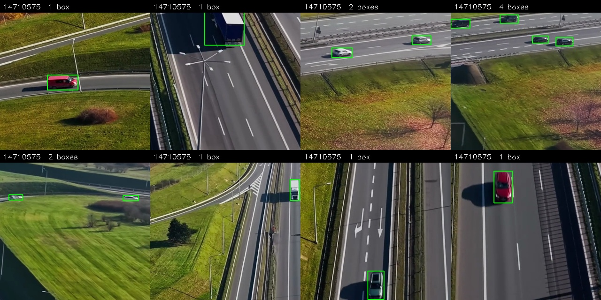
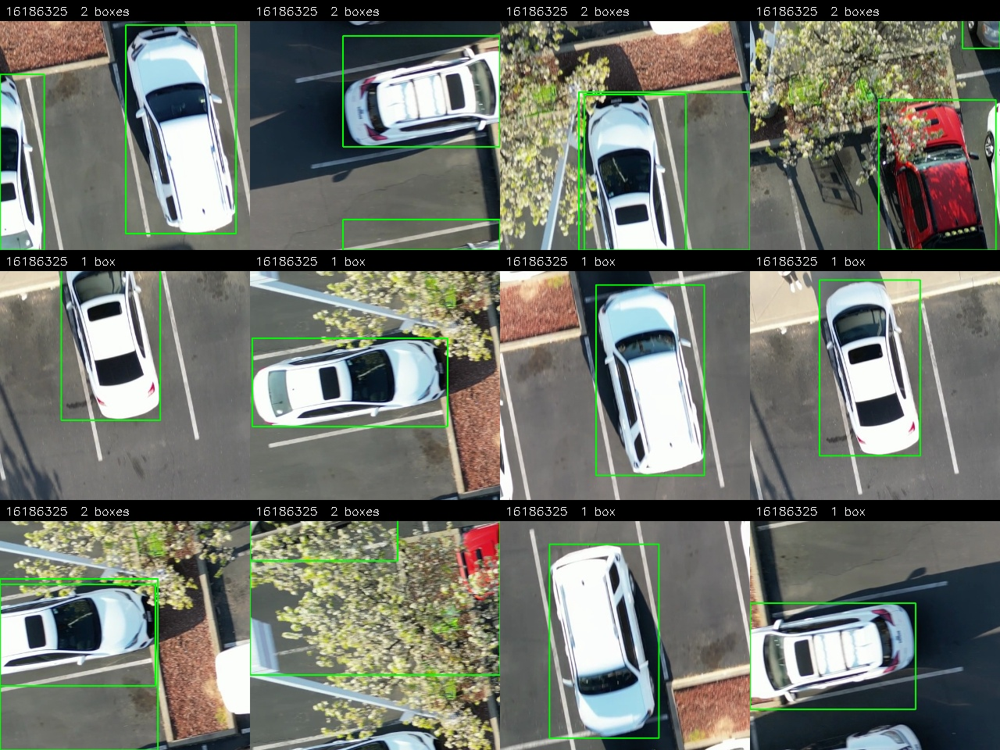
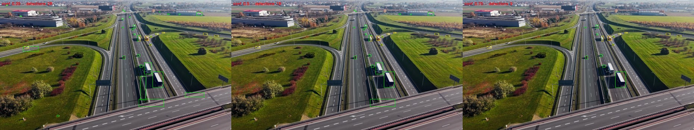
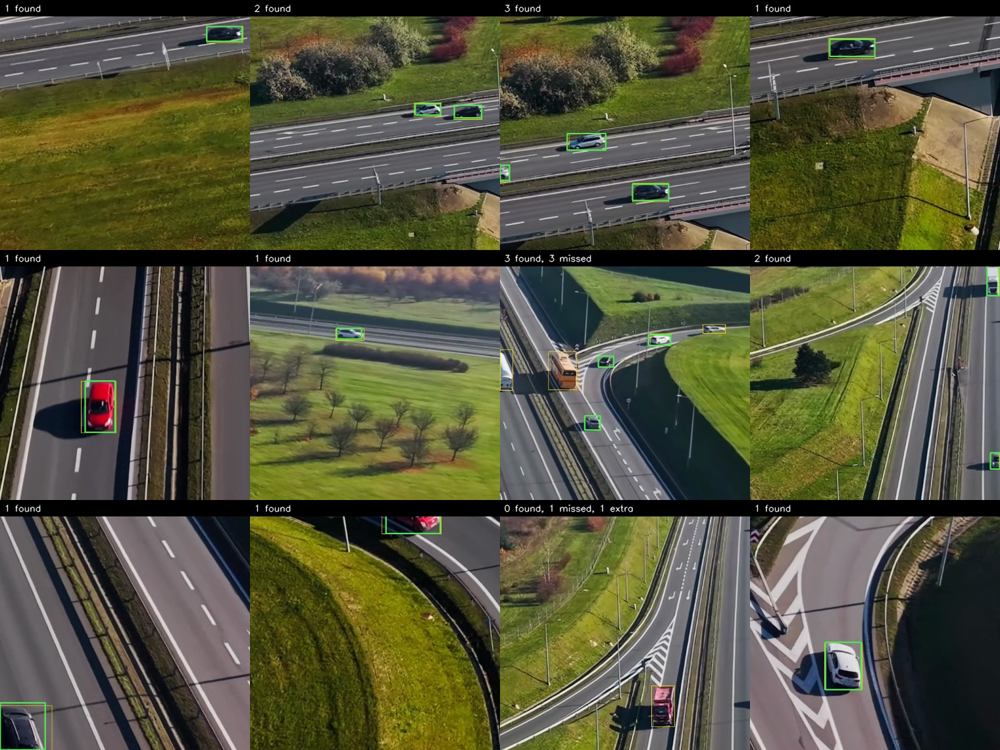
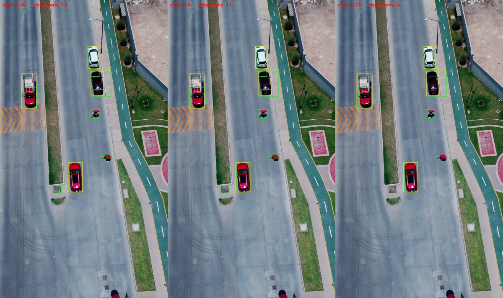

# Aerial vehicle detection — ML Engineer test task

A single-class vehicle detector for drone footage: **388,786 parameters**,
labels generated by models and corrected by hand, metrics reported separately
for 0–200 m and 200–400 m.

| | |
|---|---|
| Detector | 388,786 parameters, YOLOv8 layout with the P5 branch removed |
| Pretrain | COCO vehicle classes, trained to measure (rule 3 allows COCO) |
| Training data | 5 Pexels clips + 500 low-altitude tiles, 3300 tiles, 9661 boxes |
| Validation | one whole held-out clip, every decision made there (rule 1) |
| mAP@0.5 | 0.66 near band, 0.57 far band, 0.64 over both |
| Shipping threshold | 0.50, chosen on validation |

The task's eval clip (Pexels 32179597) could not be downloaded — the page is
behind a bot check that refuses scripted requests — so **13722965** stands in
for it, a street shot from roughly 15 m. It is a harder test than the original
would have been: the task clips are shot from about 400 m, so the substitute
differs from the training data by a factor of 25 in object size. Both clips
are measured below.

## Data

Training: the task's four clips (Pexels 8968356, 5382494, 8457857, 3405804)
plus one added clip (Pexels 15857456, a wide highway shot from altitude, added
for vehicles far enough away to populate the 200–400 m band — rule 4 allows
it), all at native resolution. `data/README.md` lists every clip, where to
download it, and the exact commands that turn clips into the training set.

Frames are cut into **512 px tiles** rather than downscaled: a distant vehicle
is 10–20 px and would vanish at 640-px full-frame inference. The same tiling
runs at inference (`eval/predict_video.py`, 128 px overlap, class-agnostic NMS
on the merged frame), so train and test see one object scale.

Tiles are spread thin across many frames rather than dense over few — the
clips are 17–31 s, so frame diversity is the scarce resource, not tile count
(`labeling/build_dataset.py`).

Validation is a **whole held-out clip** (Pexels 14710575, labelled with the
same pipeline, never trained on). Checkpoint and confidence threshold are
picked on footage the model has never seen, which a within-clip temporal split
cannot guarantee — neighbouring frames are near-duplicates. The eval clip
stays untouched by every one of those decisions (rule 1).

`training/build_dataset.py` assembles the final `train/val` folders and
`data.yaml`; `training/make_split.py` remains for a temporal split when only
the four task clips are available.

| Split | Clip | Tiles | Boxes |
|-------|------|-------|-------|
| train | 15857456 | 794 | 3878 |
| train | 5382494 | 787 | 784 |
| train | 8968356 | 506 | 3156 |
| train | 3405804 | 469 | 404 |
| train | 8457857 | 244 | 755 |
| train | 16186325, low altitude | 500 | 684 |
| **train total** | | **3300** | **9661** |
| **val** | 14710575, held out whole | **698** | **747** |

897 of those tiles hold no vehicle at all — 697 in the five clips from
altitude, 200 in the validation clip — and they are there on purpose: a tiled
detector spends most of its inference on empty ground, and without empty
ground in training it never learns to stay quiet.

Those empty tiles are not simply the frame minus the labels — they go through
three steps of their own:

1. **Emptiness is verified, not assumed** (`cut_empty.py`). A tile counts as
   background only when the open-vocabulary detector found nothing in it at a
   0.1 confidence floor, far below the threshold used for accepting labels. A
   tile holding one faint car would otherwise be taught as empty, which is the
   one mistake that teaches the model to ignore real vehicles.
2. **Per-clip quotas, spread over the timeline** (`assemble_bg.py`). Background
   from one clip teaches one scene, so each clip gets a quota instead of
   whatever it happens to yield, and each grid position contributes only a few
   frames spread across the clip — a hovering drone otherwise produces hundreds
   of identical tiles at the same position.
3. **Thinned by uniqueness, not at random** (`prune_bg.py`). The surviving
   tiles are embedded with the crop classifier's features and clustered with
   k-means, then exactly one tile is kept per cluster — the one closest to its
   centre. Random sampling would preserve the existing imbalance, which for a
   hovering drone means the same patch of grass several hundred times; one per
   cluster spends the budget on distinct scenes instead. The 697 background
   tiles in the training set are what survived that thinning, and the rest are
   moved aside rather than deleted so a later run can reuse them.

The 500 low-altitude tiles are chosen the same way but with farthest-point
sampling instead of k-means: each tile is described by a 16×16 thumbnail plus
its box geometry, and the next tile picked is the one furthest from everything
already chosen. From 1884 candidates (471 positions × 4 rotations) that keeps
the 500 most distinct instead of 500 near-copies of the same cars.

The low-altitude tiles exist because the five original clips only contain
vehicles 14-96 px across, and footage shot lower puts them at 250-450 px —
a range the detector had no examples of. They are cut centred on a vehicle so
it lands whole rather than sliced by a seam, and each one is also emitted
rotated by 90, 180 and 270 degrees: seen from above a scene has no gravity
direction, and right-angle rotations keep boxes exactly on the vehicle, which
arbitrary angles do not.

### Example tiles

One row per clip, four random labelled tiles each, captioned with the source
clip and the box count (`eval/render_dataset_grid.py` builds mixed sheets the
same way).


Reading down the rows shows what the detector has to cope with inside one
dataset: 8968356 is a busy interchange where a vehicle is 10–20 px and a tile
can hold seventeen of them, 5382494 is a dim rural scene where the same
vehicle is a dark smudge, 8457857 has lorries filling a third of the tile,
3405804 mixes paint and kerbs that the proposer kept mistaking for vehicles,
15857456 contributes the most distant traffic, and 16186325 — the low-altitude
clip — has one car per tile at 250–450 px.

| | |
|---|---|
|  |  |
| *the held-out validation clip* | *low-altitude tiles, rotated copies included* |

## Labels (rule 2)

No hand-drawn boxes from scratch; every box starts as model output and goes
through filters whose disagreements are cheap to review as crop contact
sheets. The stages, in `labeling/`:

1. **Propose** — YOLO-World with "…seen from above" prompts, tiled over full
   frames (`tiled_yoloworld.py`). Prompt phrasing roughly doubles recall over
   bare nouns; distractor prompts (lane paint, rooftops, kerbs) soak up the
   false positives. A custom intermediate detector and YOLOE run as second
   opinions (`pipeline_v1.py`, `agree_filter.py`): their errors barely
   overlap, so cross-model agreement beats either model's own confidence.
2. **Score** — every crop goes through a 2-class vehicle/non-vehicle
   classifier (`classify_crops.py`); one score decides acceptance regardless
   of which detector proposed the box.
3. **Recover & correct** — passes that chase specific, observed failure
   modes: YOLO-World top-ups for two-wheelers the other models are blind to
   (`yw_additions.py`, `yw_topup_v1.py`), re-admitting large vehicles an area
   cap had wrongly deleted (`bigbox_pass.py`), splitting road-sized boxes
   into the vehicles actually inside them (`split_big.py`), and MobileSAM
   box-refit with guards that keep a leaking mask from corrupting a good box
   (`refine_boxes.py`). Embedding similarity sweeps recurring junk (traffic
   cones, road markings) in one move (`separate_similar.py`).
4. **Export & eyeball** — labels rebuilt from whatever is currently accepted
   on disk (`export_labels.py`), rendered back onto the source frames as video
   (`render_valid.py`) for a final visual pass.
5. **Review in Label Studio** — `yolo_to_labelstudio.py` opens a project with
   the current labels as pre-annotations (so the work is correcting boxes, not
   drawing them) and registers the tile folders as local storage;
   `labelstudio_to_yolo.py` writes the corrected export back over the split,
   and `labelstudio_diff.py` prints the added / removed / fixed counts rule 2
   asks for by diffing against the pristine originals.
6. **Clean up** — `filter_slivers.py` drops boxes thinner than 7 px, the
   crumbs tile edges leave behind, while keeping substantially visible clipped
   vehicles: removing those would teach the model that half a car is
   background. For evaluation ground truth `filter_road_boxes.py` additionally
   vetoes boxes a distractor claims, boxes off the road surface and boxes too
   elongated to be a vehicle.

**What the proposers contribute, measured.** Running both allowed detectors
over all 2800 training tiles and diffing against the labels that ship (8977
boxes), a box counts as agreeing at IoU ≥ 0.5:

| | YOLO-World @0.10 | YOLO-World @0.25 | Both detectors must agree |
|---|---|---|---|
| Boxes proposed | 18,221 | 9,313 | **6,372** |
| Match a shipped label | 6,759 | 5,243 | **5,483** |
| Precision against the labels | 37% | 56% | **86%** |
| **Would have to be removed** | 8,341 | 2,762 | **889** |
| **Would have to be fixed** (overlaps, box too far off) | 3,121 | 1,308 | — |
| **Added** | 2,218 | 3,734 | 3,494 |
| Share of the labels recovered | 75% | 58% | 61% |

Agreement between an open-vocabulary detector and a stock COCO detector beats
simply raising the threshold on one of them: at a *higher* recall than
YOLO-World at 0.25 it leaves nine times less to delete. Both models are
permitted by rule 3, and their errors barely overlap — the prompt-driven one
scatters low-confidence boxes over kerbs and rooftops, the COCO one knows a
car but was trained on ground-level views and misses small top-down vehicles
(it contributed only 1,448 boxes of its own against 11,816).

The 3,494 boxes added on top of the agreed set are two-wheelers, vehicles in
shadow, and anything small enough that the COCO detector never sees it.

**Correction tally (rule 2).** Reviewing 311 of the 2800 training tiles in
Label Studio: **654 boxes added, 229 removed, 50 moved or resized** (IoU below
0.9 against the original), 1729 left untouched. `filter_slivers.py` then
dropped 120 boxes thinner than 7 px. The reviewed tiles alone changed about a
third of their boxes, which is the honest reading of how clean a pseudo-label
pipeline is before a human looks at it. On the two low-altitude clips the
review ran over crops instead of tiles: 45 of 521 boxes removed on one, 122 of
890 on the other.

## The model (rule 5)

**388,786 parameters** against the 500,000 budget, 2.3 GFLOPs on a 512 px tile
(`configs/vehicle_tiny_p34.yaml`; check the count with
`python training/train.py --count-only`). A YOLOv8 layout cut down twice —
yolov8n is 3.16 M parameters and yolo11n 2.62 M, so this is roughly 8× smaller:

- **P5 (stride-32) branch removed**, backbone and head, leaving detection on
  P3/8 and P4/16. P5 is for objects that fill the frame, and the widest layers
  in the network sit there, so it is both the least useful branch on this data
  and the most expensive one to keep. What it would have covered, P4 already
  does: DFL regression reaches 15 strides either side of an anchor, i.e. box
  sides up to 480 px, and 9 of 9661 labelled boxes exceed that.
- **width 0.25 with channels capped at 192** (yolov8n caps at 1024), so no
  layer is wider than 48 channels after scaling. One class of one object type
  needs far less feature capacity than COCO's eighty.

Where the parameters sit is worth knowing before trying to trim further:
backbone 109k (28%), neck 58k (15%), detection head 221k (57%). The head
dominates because DFL spends 64 outputs per anchor on box regression alone,
which is also why widening its range is unaffordable — reg_max 16 → 24 would
cover 736 px vehicles directly and costs 130k parameters, breaking rule 5.

No published checkpoint has this shape, so the pretrain is made to measure:
the same architecture trained on COCO's vehicle classes (allowed by rule 3),
and those weights transfer into the fine-tune almost whole — 239 of 243
tensors, only the final class convolutions differ. It is worth 0.13 mAP over
the same recipe from scratch (0.871 against 0.743 on validation tiles).

### Recommended use: 50–400 m

A detector's usable altitude is set by the object sizes it was trained on, not
by anything in the architecture. Through the pinhole model — 4K frame, 4.5 m
vehicle, 84° FOV — the shipped training set's boxes read:

| Box long side in training | Distance to camera |
|---------------------------|--------------------|
| 12 px (5th percentile) | 785 m |
| 28 px (median) | 343 m |
| 64 px (75th percentile) | 150 m |
| 176 px (90th percentile) | 55 m |
| 317 px (95th percentile) | 30 m |
| 424 px (99th percentile) | 23 m |

So 90% of the training signal lies between roughly 55 m and 785 m, and 46% of
all boxes fall inside 50–400 m exactly (24–192 px). The validation clip, which
every number in the next section is measured on, spans 35–420 m (boxes 23–275
px, 5th to 95th percentile 62–320 m). **50–400 m is therefore both where the
model has seen the most and the only range where its behaviour is measured
rather than extrapolated** — that is the recommendation. The task's two bands,
0–200 m and 200–400 m, are covered by it apart from the closest 50 m, where
the input-scale note below applies.

Outside the band the two failures are not the same failure:

- **Above ~400 m** vehicles fall under 24 px, toward the 7 px minimum box the
  labels allow, and recall degrades gradually — the far band scores 0.57
  against the near band's 0.66.
- **Below ~50 m** vehicles grow past anything the clips from altitude contain
  and eventually past P4's 480 px ceiling. The failure is not blindness but
  localisation: the model finds the vehicle and draws a box around part of it,
  which counts as a miss and a false alarm at once. This one is recoverable
  without retraining — `--input-scale 0.25` shrinks the frame before tiling
  and moves the 15 m eval clip from 0.60 to 0.87 mAP.

## Results

The shipped weights were fine-tuned on the five task clips plus 500 tiles of
low-altitude footage (clip 16186325, added under rule 4 so the detector sees
vehicles larger than the task clips contain). They were picked over the
variant trained on the task clips alone because they hold up at both altitudes
with one configuration: that variant scores 0.02 higher on the validation clip
but needs the input rescaled per clip to work on low-altitude footage.

**Validation clip 14710575, by confidence threshold**

| Metric | 0.35 | 0.50 | 0.75 |
|--------|------|------|------|
| Detection rate, 0–200 m | 0.70 | 0.66 | 0.45 |
| Detection rate, 200–400 m | 0.54 | 0.51 | 0.40 |
| Precision, 0–200 m | 0.70 | 0.81 | 0.89 |
| Precision, 200–400 m | 0.73 | 0.85 | 0.93 |
| False alarms FP×60/N_frames, 0–200 m | 60.9 | 30.4 | 11.0 |
| False alarms FP×60/N_frames, 200–400 m | 11.5 | 5.3 | 1.8 |
| Time to first detection, median s | 0.00 | 0.00 | 0.24 |

mAP@0.5 is threshold-independent: **0.66 near, 0.57 far, 0.64 over both bands**
(the bonus metric). Ground truth here is the labelled tiles projected back
into frame coordinates, covering 16% of each frame, and predictions are
counted only inside that area.



*The same frame at 0.35, 0.50 and 0.75. Green: detections, yellow: ground
truth. Raising the threshold clears empty boxes on the motorway first and
drops distant vehicles last.*

**On individual tiles**, which is what the network actually sees, taken every
41st tile through the validation split so the sheet is spaced rather than
picked (`eval/render_tile_detections.py`):



*Green: a detection that matches a label. Red: a detection that matches
nothing. Yellow alone: a vehicle nobody found. 17 found, 4 missed, 1 false
alarm across these twelve tiles. The one red box is the failure worth
understanding — the model found the truck and boxed a third of it, which
scores as a miss and a false alarm at once.*

Recall over the whole split, by how large the vehicle is, same per-tile
inference at 0.50:

| Ground-truth box | Vehicles | Recall |
|------------------|----------|--------|
| under 32 px | 47 | 0.60 |
| 32–64 px | 266 | 0.64 |
| 64–96 px | 195 | 0.71 |
| over 96 px | 239 | 0.80 |

Recall rises with size, monotonically — the limit on this data is resolution,
not shape. (These are per-tile numbers and sit above the frame-level detection
rates in the table: a tile is a clean 512 px crop, while the full frame also
has to survive seam stitching and merging.)

On the 200 empty validation tiles the detector stays quiet on 95% of them at
the shipping threshold: 10 tiles produce a box, 13 boxes in total. At 0.35
that becomes 18 tiles and 25 boxes, at 0.75 three tiles and three boxes.

**Eval clip 13722965, by the same thresholds**

| Metric | 0.35 | 0.50 | 0.75 |
|--------|------|------|------|
| Detection rate, 0–200 m | 0.80 | 0.78 | 0.66 |
| Precision, 0–200 m | 0.19 | 0.28 | 0.60 |
| False alarms FP×60/N_frames | 538.6 | 324.9 | 70.4 |

mAP@0.5 over both bands: **0.60** at the clip's native resolution, **0.87**
if the frame is scaled so vehicles land in the trained size range. The
200–400 m column is empty because nothing in this clip is beyond 200 m.



*Every labelled vehicle is found, including the loaded pickup and the cars in
shadow. The extra boxes are umbrellas and drain covers — compact,
high-contrast objects about the size of a vehicle at this altitude, and
nothing in the training set says what they are.*

### Where these numbers hold

Inside 50–400 m, for the reasons set out above. The eval clip is the concrete
case of going outside it: shot from about 15 m, median vehicle 372 px, 13
times the training median. The 500 low-altitude tiles are what keeps it usable
at all — without them the same architecture and pretrain score 0.39 instead of
0.60 at native resolution, and 0.25 input scaling lifts it to 0.87.

Two ways of faking that footage were measured and rejected: upscaled crops of
small vehicles moved the low-altitude clip by 0.02, far less than real footage
did, and 960 further street tiles cut with a 1.6x zoom made it worse again
(0.50). Resolution cannot be invented by stretching pixels.

### Distance model and its assumptions

Pinhole: `d = f_px · L / p`, with `f_px = W / (2·tan(hfov/2))`, `p` the box's
long side in pixels. Assumed: horizontal FOV **84°** (typical consumer drone
main camera), nominal vehicle length **L = 4.5 m**, box long side ≈ vehicle
length. `d` is slant range. Trucks/buses therefore read closer than they are,
and oblique views slightly overestimate distance; both effects and the chosen
constants are in `eval/distance.py`, change them there to disagree.

## Training

```
python training/train.py --data <dataset>/data.yaml --pretrain-coco  # 2 stages
python training/train.py --data <dataset>/data.yaml                  # scratch
```

imgsz 512 (= tile size), 250 epochs with cosine LR, mosaic off for the last
20 epochs; the parameter budget is asserted before every run. `--pretrain-coco`
runs the COCO-vehicles pretrain described above first (≈20 GB COCO download —
do it on the pod); `--pretrained <ckpt>` instead transfers whatever matches by
shape from any checkpoint. The shipping checkpoint and confidence threshold
are picked on the validation split only (rule 1).

Training runs locally (`--device auto` picks CUDA, then Apple MPS, then CPU)
or on a rented RunPod GPU via `cloud/` — a slim port of a production cloud
runner, kept to what this task needs (rsync code + dataset up, detached task
that survives dropped SSH, crash-restart from the last checkpoint, artifacts
back to `runs/cloud/<run_id>`; no S3/MLflow):

```
python cloud/train_remote.py --list-gpus                      # prices & stock
python cloud/train_remote.py --data dataset_final/data.yaml \
    --gpu rtx-3090 --estimate-only                            # plan & cost
python cloud/train_remote.py --data dataset_final/data.yaml --gpu rtx-3090
python cloud/train_remote.py --where local                    # laptop mode
```

Needs `RUNPOD_API_KEY` (env or `.env`) and an ed25519 SSH key; pod settings
live in `configs/runpod.yaml`. Ctrl+C detaches without killing the run.

## Eval

```
# 1. predictions over the full confidence range (AP needs it)
python eval/predict_video.py --video <eval.mp4> --weights <best.pt> --conf 0.05
# 2. ground truth: label the eval clip with the same pipeline, then correct it;
#    store as csv: frame,x1,y1,x2,y2
# 3. banded metrics; --conf here is the shipping threshold from training data
python eval/eval_bands.py --gt gt.csv --pred eval_run/predictions.csv \
    --img-width 3840 --fps 30 --conf <shipping>
python eval/render_examples.py --video <eval.mp4> --gt gt.csv \
    --pred eval_run/predictions.csv --conf <shipping>
```

TP/FN land in the band of the GT box, FP in the band of the prediction's own
estimated distance. Time to first detection links GT boxes into tracks by IoU
across frames (no identity in the csv), then measures first-appearance to
first-match per track; the script also reports how many tracks were never
detected, which the median alone would hide.

Band coverage (rule 4): ⟨TODO — confirm the eval clip has vehicles in the
200–400 m band; if not, name the added clip here⟩.

## Repo layout

```
data/        clip manifest, fetch helper, and how clips become the dataset
configs/     model yaml (the <500k detector) and the RunPod profile
labeling/    propose → score → correct → Label Studio review → export
training/    dataset assembly + training with the parameter-budget assert
cloud/       RunPod launcher: same training, rented GPU, one command
eval/        tiled inference, distance model, banded metrics, contact sheets
examples/    labelled-tile grids and eval frames, GT vs predictions
weights/     final checkpoint
```

Labeling and training scripts run **from a workspace directory** holding the
videos and datasets (paths resolve against the cwd), so the repo stays free of
multi-GB artefacts. `requirements.txt` + ffmpeg on PATH is the full setup.

## What we tried and measured

Every row is the same detector, measured on the held-out validation clip and
on a low-altitude clip the model never trained on (13722965, vehicles ~372 px
against 25 px in the training tiles). It is the second column that separates
the ideas that work from the ones that only sound good.

| Run | Change | val mAP@0.5 | low-altitude clip |
|-----|--------|-------------|-------------------|
| scratch | from scratch, 389k | 0.743 | — |
| wide | 481k, from scratch | 0.778 | — |
| athug / wideaug | rotations ±30°, flipud | 0.700 / 0.718 | — |
| **ft** | **COCO-vehicles pretrain** | **0.871** | 0.39 |
| ftwide | the same pretrain, 481k | 0.851 | — |
| ftzoombig | + upscaled crops of small vehicles | 0.862 | 0.41 |
| **ftla500** | **+ 500 tiles of real low-altitude footage** | 0.835 | **0.60** |
| ftfull | + 960 upscaled street tiles | 0.841 | 0.50 |
| ftwidefull | the same, 481k | 0.839 | 0.46 |

What the numbers say:

- **The pretrain is the single biggest win** (+12.8 mAP). No published
  checkpoint fits a 389k model, so the pretrain is trained to measure on
  COCO's vehicle classes, which rule 3 allows.
- **Capacity is not the bottleneck, data is.** 481k beat 389k while both
  trained from scratch (+3.5), and lost once the pretrain removed the
  underfitting. The best epoch tells the same story: 6 with the pretrain
  against 167 without it.
- **Rotations and vertical flips cost 4-6 mAP.** An axis-aligned box around a
  vehicle rotated 30° is far larger than the vehicle, so the box regression
  learns the wrong sizes. Right-angle rotations, baked into the low-altitude
  tiles, keep boxes exact and do not have this problem.
- **Upscaling does not substitute for resolution.** Zoomed crops of 25 px
  vehicles (ftzoombig) moved the low-altitude clip by 0.02; 500 tiles of
  footage actually shot from low altitude moved it by 0.21. Adding 960
  upscaled street tiles on top made it worse again.

## What next

In the order I would actually do them:

1. **Finish the label review.** 311 of 2800 tiles were reviewed and those
   alone changed a third of their boxes. The remaining 2489 almost certainly
   hold a comparable share of errors, and label noise caps everything else.
2. **Hard negatives for the objects that cause the false alarms.** Umbrellas,
   drain covers and road signs are what precision loses to on the low-altitude
   clip, not missed vehicles. 200 vehicle-free tiles are already cut
   (`dataset_street_bg`); the run that uses them is not in the table yet.
3. **More low-altitude clips.** 500 tiles from one parking lot moved the
   low-altitude score by 0.21; the clip only contains about 70 distinct
   vehicles, so a second and third location would matter more than more tiles
   from this one.
4. **Temporal smoothing at inference.** Every metric here is per frame, but
   vehicles persist: a tracker would suppress single-frame false alarms and
   recover single-frame misses at no training cost.

## Decided against

- **DINO feature distillation** for the backbone: no pretrained weights fit
  the custom scaling anyway, the gain at 389k parameters on a narrow domain
  does not pay for the compute, and the pseudo-label pipeline is already
  teacher→student distillation.
- **A wider model.** 481k parameters (the budget allows it) beat 389k when
  both trained from scratch, and lost once the pretrain removed the
  underfitting — see the table above.
- **Aggressive augmentation.** Rotations and vertical flips cost 4–6 mAP; an
  axis-aligned box around a vehicle rotated 30° is much larger than the
  vehicle itself.
- **Image-pyramid inference.** It fixed fragmented boxes on low-altitude
  footage but tripled inference cost, and a single scale matched to the
  capture altitude does the same job.

## AI assistance

Parts of the tooling and this README were written with an AI assistant. Every
design decision was mine, every number in this document comes from a run I can
reproduce with the commands above, and the experiments that failed are in the
table next to the ones that worked.
