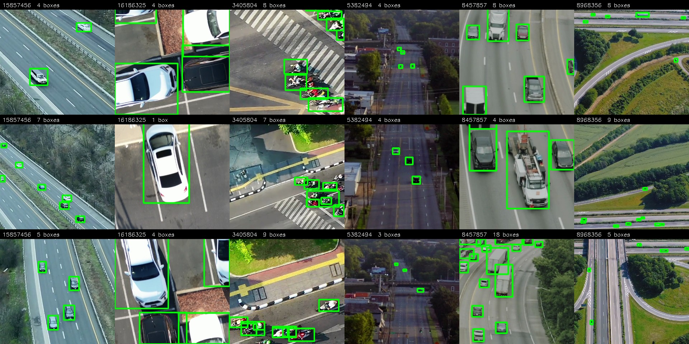
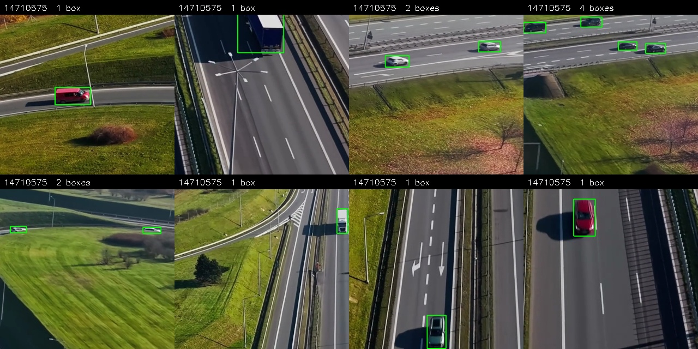
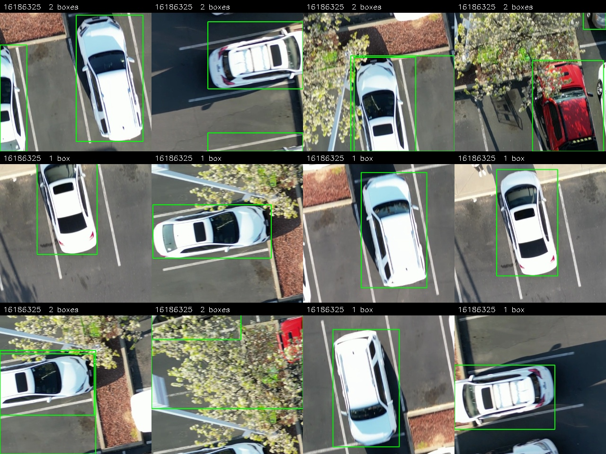

# How the dataset and the labels were built

The full account behind the README's two short sections: which frames became
tiles, how every box was proposed, filtered and corrected, and what the review
changed.

## Data

Training: the task's four clips (Pexels 8968356, 5382494, 8457857, 3405804)
plus one added clip (Pexels 15857456, a wide highway shot from altitude, added
for vehicles far enough away to populate the 200–400 m band), all at native resolution. `data/README.md` lists every clip, where to
download it, and the exact commands that turn clips into the training set.

Frames are cut into **512 px tiles** rather than downscaled: a distant vehicle
is 10–20 px and would vanish at 640-px full-frame inference. The same tiling
runs at inference (`eval/predict_video.py`, 128 px overlap, class-agnostic NMS
on the merged frame), so train and test see one object scale.

Tiles are spread thin across many frames rather than dense over few — the
clips are 17–31 s, so frame diversity is the scarce resource, not tile count
(`labeling/build_dataset.py`).

Validation is a **whole held-out clip** (Pexels 14710575, labelled with the
same pipeline, never trained on). Checkpoint and confidence threshold are
picked on footage the model has never seen, which a within-clip temporal split
cannot guarantee — neighbouring frames are near-duplicates. The eval clip
stays untouched by every one of those decisions.

`training/build_dataset.py` assembles the final `train/val` folders and
`data.yaml`; `training/make_split.py` remains for a temporal split when only
the four task clips are available.

| Split | Clip | Tiles | Boxes |
|-------|------|-------|-------|
| train | 15857456 | 794 | 3878 |
| train | 5382494 | 787 | 784 |
| train | 8968356 | 506 | 3156 |
| train | 3405804 | 469 | 404 |
| train | 8457857 | 244 | 755 |
| train | 16186325, low altitude | 500 | 684 |
| **train total** | | **3300** | **9661** |
| **val** | 14710575, held out whole | **698** | **747** |

897 of those tiles hold no vehicle at all — 697 in the five clips from
altitude, 200 in the validation clip — and they are there on purpose: a tiled
detector spends most of its inference on empty ground, and without empty
ground in training it never learns to stay quiet.

Those empty tiles are not simply the frame minus the labels — they go through
three steps of their own:

1. **Emptiness is verified, not assumed** (`cut_empty.py`). A tile counts as
   background only when the open-vocabulary detector found nothing in it at a
   0.1 confidence floor, far below the threshold used for accepting labels. A
   tile holding one faint car would otherwise be taught as empty, which is the
   one mistake that teaches the model to ignore real vehicles.
2. **Per-clip quotas, spread over the timeline** (`assemble_bg.py`). Background
   from one clip teaches one scene, so each clip gets a quota instead of
   whatever it happens to yield, and each grid position contributes only a few
   frames spread across the clip — a hovering drone otherwise produces hundreds
   of identical tiles at the same position.
3. **Thinned by uniqueness, not at random** (`prune_bg.py`). The surviving
   tiles are embedded with the crop classifier's features and clustered with
   k-means, then exactly one tile is kept per cluster — the one closest to its
   centre. Random sampling would preserve the existing imbalance, which for a
   hovering drone means the same patch of grass several hundred times; one per
   cluster spends the budget on distinct scenes instead. The 697 background
   tiles in the training set are what survived that thinning, and the rest are
   moved aside rather than deleted so a later run can reuse them.

The 500 low-altitude tiles are chosen the same way but with farthest-point
sampling instead of k-means: each tile is described by a 16×16 thumbnail plus
its box geometry, and the next tile picked is the one furthest from everything
already chosen. From 1884 candidates (471 positions × 4 rotations) that keeps
the 500 most distinct instead of 500 near-copies of the same cars.

The low-altitude tiles exist because the five original clips only contain
vehicles 14-96 px across, and footage shot lower puts them at 250-450 px —
a range the detector had no examples of. They are cut centred on a vehicle so
it lands whole rather than sliced by a seam, and each one is also emitted
rotated by 90, 180 and 270 degrees: seen from above a scene has no gravity
direction, and right-angle rotations keep boxes exactly on the vehicle, which
arbitrary angles do not.

### Example tiles

One row per clip, four random labelled tiles each, captioned with the source
clip and the box count (`eval/render_dataset_grid.py` builds mixed sheets the
same way).

Reading down the rows shows what the detector has to cope with inside one
dataset: 8968356 is a busy interchange where a vehicle is 10–20 px and a tile
can hold seventeen of them, 5382494 is a dim rural scene where the same
vehicle is a dark smudge, 8457857 has lorries filling a third of the tile,
3405804 mixes paint and kerbs that the proposer kept mistaking for vehicles,
15857456 contributes the most distant traffic, and 16186325 — the low-altitude
clip — has one car per tile at 250–450 px.

| | |
|---|---|
|  |  |
| *the held-out validation clip* | *low-altitude tiles, rotated copies included* |

## Labels

No hand-drawn boxes from scratch; every box starts as model output and goes
through filters whose disagreements are cheap to review as crop contact
sheets. The stages, in `labeling/`:

1. **Propose** — YOLO-World with "…seen from above" prompts, tiled over full
   frames (`tiled_yoloworld.py`). Prompt phrasing roughly doubles recall over
   bare nouns; distractor prompts (lane paint, rooftops, kerbs) soak up the
   false positives. A custom intermediate detector and YOLOE run as second
   opinions (`pipeline_v1.py`, `agree_filter.py`): their errors barely
   overlap, so cross-model agreement beats either model's own confidence.
2. **Score** — every crop goes through a 2-class vehicle/non-vehicle
   classifier (`classify_crops.py`); one score decides acceptance regardless
   of which detector proposed the box.
3. **Recover & correct** — passes that chase specific, observed failure
   modes: YOLO-World top-ups for two-wheelers the other models are blind to
   (`yw_additions.py`, `yw_topup_v1.py`), re-admitting large vehicles an area
   cap had wrongly deleted (`bigbox_pass.py`), splitting road-sized boxes
   into the vehicles actually inside them (`split_big.py`), and MobileSAM
   box-refit with guards that keep a leaking mask from corrupting a good box
   (`refine_boxes.py`). Embedding similarity sweeps recurring junk (traffic
   cones, road markings) in one move (`separate_similar.py`).
4. **Export & eyeball** — labels rebuilt from whatever is currently accepted
   on disk (`export_labels.py`), rendered back onto the source frames as video
   (`render_valid.py`) for a final visual pass.
5. **Review in Label Studio** — `yolo_to_labelstudio.py` opens a project with
   the current labels as pre-annotations (so the work is correcting boxes, not
   drawing them) and registers the tile folders as local storage;
   `labelstudio_to_yolo.py` writes the corrected export back over the split,
   and `labelstudio_diff.py` prints the added / removed / fixed counts by
   diffing against the pristine originals.
6. **Clean up** — `filter_slivers.py` drops boxes thinner than 7 px, the
   crumbs tile edges leave behind, while keeping substantially visible clipped
   vehicles: removing those would teach the model that half a car is
   background. For evaluation ground truth `filter_road_boxes.py` additionally
   vetoes boxes a distractor claims, boxes off the road surface and boxes too
   elongated to be a vehicle.

**What the proposers contribute, measured.** Running both allowed detectors
over all 2800 training tiles and diffing against the labels that ship (8977
boxes), a box counts as agreeing at IoU ≥ 0.5:

| | YOLO-World @0.10 | YOLO-World @0.25 | Both detectors must agree |
|---|---|---|---|
| Boxes proposed | 18,221 | 9,313 | **6,372** |
| Match a shipped label | 6,759 | 5,243 | **5,483** |
| Precision against the labels | 37% | 56% | **86%** |
| **Would have to be removed** | 8,341 | 2,762 | **889** |
| **Would have to be fixed** (overlaps, box too far off) | 3,121 | 1,308 | — |
| **Added** | 2,218 | 3,734 | 3,494 |
| Share of the labels recovered | 75% | 58% | 61% |

Agreement between an open-vocabulary detector and a stock COCO detector beats
simply raising the threshold on one of them: at a *higher* recall than
YOLO-World at 0.25 it leaves nine times less to delete. Both models are
general-purpose, and their errors barely overlap — the prompt-driven one
scatters low-confidence boxes over kerbs and rooftops, the COCO one knows a
car but was trained on ground-level views and misses small top-down vehicles
(it contributed only 1,448 boxes of its own against 11,816).

The 3,494 boxes added on top of the agreed set are two-wheelers, vehicles in
shadow, and anything small enough that the COCO detector never sees it.

**Correction tally.** Reviewing 311 of the 2800 training tiles in
Label Studio: **654 boxes added, 229 removed, 50 moved or resized** (IoU below
0.9 against the original), 1729 left untouched. `filter_slivers.py` then
dropped 120 boxes thinner than 7 px. The reviewed tiles alone changed about a
third of their boxes, which is the honest reading of how clean a pseudo-label
pipeline is before a human looks at it. On the two low-altitude clips the
review ran over crops instead of tiles: 45 of 521 boxes removed on one, 122 of
890 on the other.
