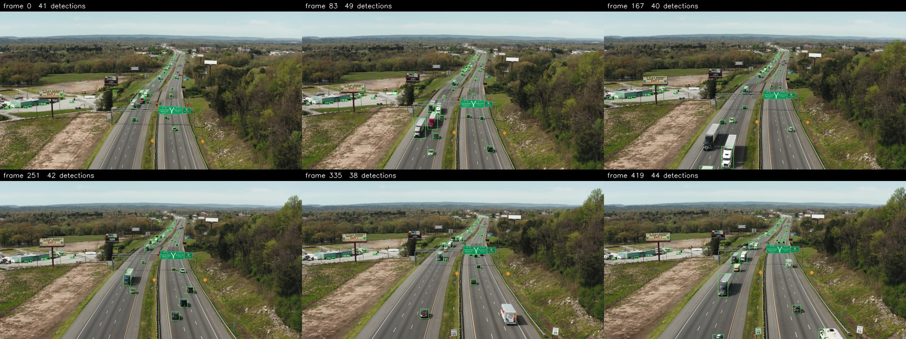
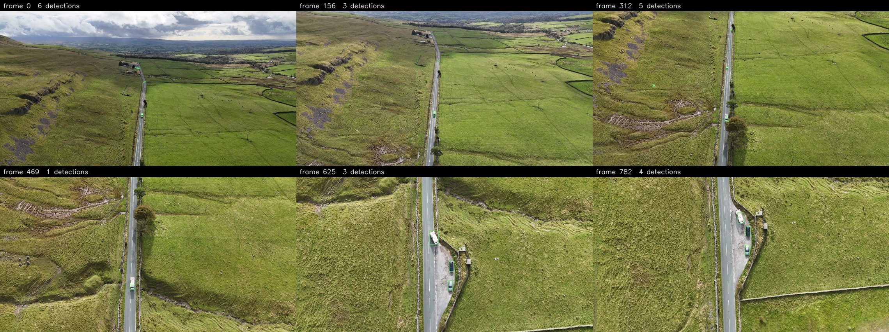

# What was tried, and what was decided against

Every run and ablation behind the numbers in the README, including the
ones that did not work.

## What we tried and measured

Every row is measured in one pass with `yolo val` on the same 698 validation tiles
at 512 px. Parameter counts are of the trained checkpoint: a model fine-tuned from
the 80-class COCO pretrain inherits that head's wider class branch.

| Run | Change | Params | val mAP@0.5 | val recall |
|-----|--------|--------|-------------|------------|
| scratch | from scratch | 388,786 | 0.740 | 0.614 |
| wide | from scratch, channel cap 224 | 480,970 | 0.770 | 0.671 |
| **shipped** | **COCO-vehicles pretrain, varied training set** | 490,482 | **0.826** | **0.739** |

Also tried and dropped: rotation and flip augmentation (0.674 and 0.710, worse than
the same models without it), classifier-cleaned labels on the wide model (0.777),
and adding 960 street tiles from
[10170445](https://www.pexels.com/video/10170445/) on top of the car-park tiles
(0.841, 0.55 on the low-altitude clip; 0.50 when zoomed; 0.46 when also wide, at
564,154 parameters).

What the numbers say:

- **The pretrain is the biggest win**: +8.6 mAP over scratch and +12.5 points of
  recall. No published checkpoint fits a model this size, so it is trained to
  measure on COCO's vehicle classes.
- **Width helps less**: +3.0 mAP from scratch.
- **Rotations and vertical flips cost 6-7 mAP.** An axis-aligned box around a
  vehicle rotated 30° is far larger than the vehicle, so box regression learns the
  wrong sizes. Right-angle rotations keep boxes exact.

## Two further clips, looked at rather than scored

Both are shot from altitude, so `--input-scale auto` leaves them at native
resolution. They carry no ground truth, so there are no metrics here — only
the output, frames spaced evenly across each clip
(`eval/render_examples.py`).

*4030687, a highway interchange: 38–49 detections per frame, holding the chain
of vehicles up the carriageway into the distance, nothing on the sky or the
tree line.*

*12450031, a rural road: 1–6 detections per frame and almost nothing spurious
across a frame of textured grass, rock and livestock.*

Looking at them turned up the limit worth recording. In frame 335 of the
interchange clip a box truck in the immediate foreground is **missed at the
shipping threshold** while a car beside it scores 0.94 — the model does find
the truck, but boxes its cab only (205×130 px of a roughly 220×290 px vehicle)
and scores that 0.36. The clip is in band on average, yet an oblique camera
spans a wide range of distances inside one frame, and the near edge of it hits
the same part-box failure as footage shot below 50 m.

## How the numbers move with the threshold

0.50 was chosen on validation. For reference, across 0.35 / 0.50 / 0.75:

| | 0.35 | 0.50 | 0.75 |
|---|------|------|------|
| Validation, detection rate near / far | 0.70 / 0.54 | 0.66 / 0.51 | 0.45 / 0.40 |
| Validation, precision near / far | 0.70 / 0.73 | 0.81 / 0.85 | 0.89 / 0.93 |
| Validation, false alarms near / far | 60.9 / 11.5 | 30.4 / 5.3 | 11.0 / 1.8 |
| Eval, detection rate near | 0.80 | 0.78 | 0.66 |
| Eval, precision near | 0.20 | 0.28 | 0.61 |
| Eval, false alarms near / far | 539.8 / 156.2 | 325.7 / 61.4 | 69.7 / 6.5 |
| Eval, tracks never detected | 1 of 12 | 1 of 12 | 2 of 12 |

mAP@0.5 is threshold-independent and does not appear here.

## Decided against

- **DINO feature distillation** for the backbone: no pretrained weights fit
  the custom scaling anyway, the gain at this size on a narrow domain
  does not pay for the compute, and the pseudo-label pipeline is already
  teacher→student distillation.
- **A wider model.** 480,970 parameters from scratch (564,154 with the COCO pretrain, over budget) beat 388,786 when
  both trained from scratch, and lost once the pretrain removed the
  underfitting — see the table above.
- **Aggressive augmentation.** Rotations and vertical flips cost 4–6 mAP; an
  axis-aligned box around a vehicle rotated 30° is much larger than the
  vehicle itself.
- **Image-pyramid inference.** It fixed fragmented boxes on low-altitude
  footage but tripled inference cost, and a single scale matched to the
  capture altitude does the same job.

## What next

In the order I would actually do them:

1. **Finish the label review.** 311 of 2800 tiles were reviewed and those
   alone changed a third of their boxes. The remaining 2489 almost certainly
   hold a comparable share of errors, and label noise caps everything else.
2. **Hard negatives for the objects that cause the false alarms.** Umbrellas,
   drain covers and road signs are what precision loses to on the low-altitude
   clip, not missed vehicles. 200 vehicle-free tiles are already cut
   (`dataset_street_bg`); the run that uses them is not in the table yet.
3. **More low-altitude clips.** 500 tiles from one parking lot moved the
   low-altitude score by 0.21; the clip only contains about 70 distinct
   vehicles, so a second and third location would matter more than more tiles
   from this one.
4. **Temporal smoothing at inference.** Every metric here is per frame, but
   vehicles persist: a tracker would suppress single-frame false alarms and
   recover single-frame misses at no training cost.
